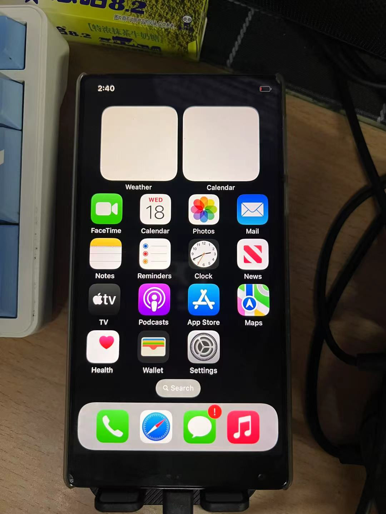
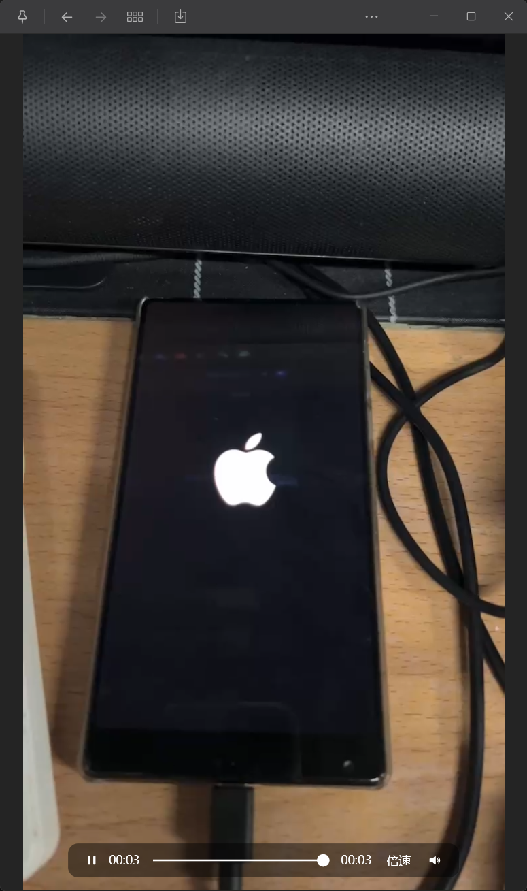
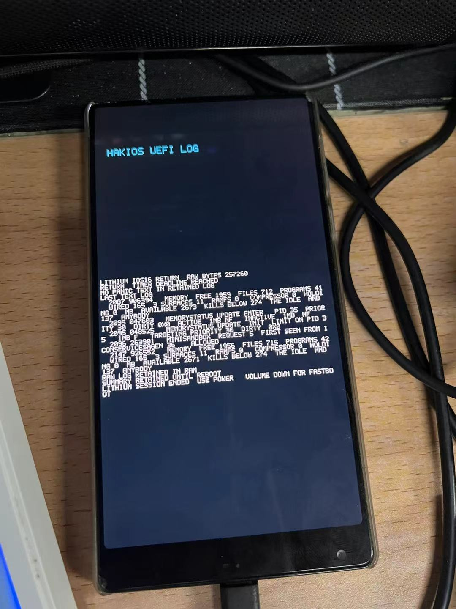

# hakios-lithium

**让iOS运行在您的小米MIX1代上。**

*Run iOS on your Xiaomi Mi MIX (1st generation).*

[中文](#项目简介) · [English](#english)

## 真机展示 / On-device photos

以下图片来自本项目已归档的 MIX 一代实机记录，保留原图。桌面照片为 R20 阶段；白苹果画面与 UEFI 摘要为更早的 R4 阶段，其中白苹果图片是实机录像截图。当前进度见下方表格。

These images come from this project's archived Mi MIX hardware sessions and are reproduced unchanged. The desktop photo is from R20; the Apple-logo frame and UEFI summary are from the earlier R4 session. The Apple-logo image is a frame captured from a real-device video. See the status table below for current progress.

  

<strong>iOS 桌面 · iOS desktop</strong> R20 · 2026-11-19 归档 / Archived November 19, 2026

<table>
  <tr>
    <td align="center" width="50%"></td>
    <td align="center" width="50%"></td>
  </tr>
  <tr>
    <td align="center"><strong>白苹果启动画面 / Apple-logo boot screen</strong> R4 · 2026-11-16</td>
    <td align="center"><strong>UEFI 调试摘要 / UEFI diagnostic summary</strong> R4 · 2026-11-16</td>
  </tr>
</table>

图片来源及 SHA-256 见 [`docs/images/PROVENANCE.json`](docs/images/PROVENANCE.json)。Photos and SHA-256 hashes are documented in the provenance file.

## 项目简介

`hakios-lithium` 是面向小米 MIX 一代（代号 `lithium`，高通 MSM8996 / Snapdragon 821）的 HakiOS / Darwin 移植项目，当前目标系统为 iOS 16.5。本仓库公开现阶段的平台适配源码、内核补丁、引导固件源码、构建与打包脚本、测试和阶段报告。

## 当前进度

截至 **2026 年 11 月 26 日**：

| 模块 | 当前状态 |
| --- | --- |
| 桌面 | 已能在真机进入 iOS 桌面（SpringBoard），显示与桌面交互可用。 |
| 触摸 | 真实触摸已接通，触摸与滑动正常。 |
| CPU | 频率配置与运行正常，当前日常交互基线为 614.4 MHz 配置；该数值是配置模型，并非独立 PMU 实测频率。 |
| GPU | 正在推进 Adreno 530 的供电、时钟、固件认证及 SMMU 适配；CP 命令提交、Metal 与 CoreAnimation 硬件加速尚未验证。 |
| 存储与引导 | 已有 UFS 启动、文件系统访问及受控退出的真机阶段记录。 |

项目仍处于开发阶段。长时间稳定性、温度表现、最佳 CPU 档位以及各子系统的完整支持继续验证中。历史报告的结论适用于各自记录的测试轮次。

## 仓库结构

| 路径 | 内容 |
| --- | --- |
| [`ports/hakios-lithium/`](ports/hakios-lithium/) | MIX 平台适配、固件板层、内核补丁、显示、触摸及 GPU 代码。 |
| [`scripts/`](scripts/) | 构建、打包、分析、检查与回归测试脚本。 |
| [`maintenance/`](maintenance/) | 主机侧测试与维护代码。 |
| [`config/`](config/) | 项目及资源配置、来源版本固定。 |
| [`firmware/`](firmware/) / [`boot/`](boot/) | 引导相关源码、集成资料与历史实现。 |
| [`diagnostics/`](diagnostics/) | 诊断定义与辅助源码。 |
| [`reports/`](reports/) | 阶段报告、主机检查记录及历史验证结果。 |
| [`upstreams.lock.json`](upstreams.lock.json) | 上游项目来源与固定版本。 |

## 源码与构建说明

这是当前工作目录的独立源码快照，包含尚未提交到原项目 Git 历史的最新适配代码。原始工作目录及 Git 状态保持不变。源码清单与 SHA-256 见 [`SOURCE-SNAPSHOT.json`](SOURCE-SNAPSHOT.json)。

活动内核基于 [HakiOS](https://github.com/oosexgang/hakios-xnu-kernel)，固定提交为 `63fc2b4633bac3af8e57dadab9f5a8d4cb940438`，对应 XNU `8796.121.2`。上游依赖不重复打包，来源与版本以 [`config/hakios-lithium.json`](config/hakios-lithium.json) 和 [`upstreams.lock.json`](upstreams.lock.json) 为准。

构建流程、依赖准备和运行边界见 [`scripts/README.md`](scripts/README.md)、[`OPERATIONS.md`](OPERATIONS.md) 与 [`PLAN.md`](PLAN.md)。[`README.workspace.md`](README.workspace.md) 保留原工作目录说明与历史记录，旧阶段状态应结合报告日期阅读。部分脚本包含开发环境路径，使用前需要按本机环境配置。

仓库提供源码与研究记录，尚未提供一键安装包。Apple 系统镜像、IPSW、原厂固件、设备原始日志和编译产物不在本次发布范围内，所需系统文件由使用者自行合法准备。

## 致谢与许可

感谢 HakiOS、Apple 开源 XNU、Mu / EDK II、Freedreno / Mesa 及各相关上游项目。

保留原有许可证与作者声明：XNU 派生代码适用 APSL 2.0，HakiOS 自有组件按上游声明适用 MIT，其他第三方代码遵循各自许可证。详见 [`LICENSE`](LICENSE)、[`LICENSE.APSL`](LICENSE.APSL)、[`NOTICE`](NOTICE) 和 [`THIRD_PARTY_LICENSES.md`](THIRD_PARTY_LICENSES.md)。

---

## English

### Overview

**Run iOS on your Xiaomi Mi MIX (1st generation).**

`hakios-lithium` is a HakiOS / Darwin port for the first-generation Xiaomi Mi MIX (`lithium`, Qualcomm MSM8996 / Snapdragon 821), currently targeting iOS 16.5. This repository publishes the current platform integration sources, kernel patches, boot firmware sources, build and packaging scripts, tests, and milestone reports.

### Current progress

As of **November 26, 2026**:

| Component | Status |
| --- | --- |
| Desktop | Boots to the iOS desktop (SpringBoard) on real hardware, with working display output and desktop interaction. |
| Touch | Real touchscreen input and swipe gestures work normally. |
| CPU | Frequency configuration and operation work normally. The current everyday interaction baseline uses a 614.4 MHz configuration; this is a configuration model, not an independently measured PMU frequency. |
| GPU | Adreno 530 power, clocks, firmware authentication, and SMMU integration are in progress. CP command submission, Metal, and CoreAnimation hardware acceleration remain unverified. |
| Storage and boot | Milestone reports document UFS boot, filesystem access, and controlled shutdown / return tests on real hardware. |

Development is ongoing. Long-duration stability, thermal behavior, the best CPU operating point, and complete subsystem support remain under evaluation. Each historical report describes its own test session.

### Source layout and building

- `ports/hakios-lithium/`: platform integration, firmware, kernel patches, display, touch, and GPU code.
- `scripts/` and `maintenance/`: build, packaging, analysis, validation, and host tests.
- `config/` and `upstreams.lock.json`: configuration and pinned upstream revisions.
- `firmware/`, `boot/`, and `diagnostics/`: boot sources, historical implementation, and diagnostics.
- `reports/`: milestone reports and recorded validation results.

This is an independent snapshot of the current working sources, including the latest integration code that has not been committed to the original repository. The original working directory and Git state are preserved. See [`SOURCE-SNAPSHOT.json`](SOURCE-SNAPSHOT.json) for the file manifest and SHA-256 hashes.

The active kernel is based on [HakiOS](https://github.com/oosexgang/hakios-xnu-kernel) commit `63fc2b4633bac3af8e57dadab9f5a8d4cb940438` and XNU `8796.121.2`. Upstream dependencies are acquired separately using the pinned configuration.

Read [`scripts/README.md`](scripts/README.md), [`OPERATIONS.md`](OPERATIONS.md), and [`PLAN.md`](PLAN.md) for the existing build workflow and operating constraints. [`README.workspace.md`](README.workspace.md) preserves the original workspace documentation and historical notes. Some scripts contain development-machine paths and require local configuration.

This is a source publication; a turnkey installer is not yet available. Apple system images, IPSW files, OEM firmware, raw device logs, and compiled outputs are excluded. Users must obtain any required system files lawfully.

### Acknowledgments and licensing

Thanks to HakiOS, Apple's open-source XNU, Mu / EDK II, Freedreno / Mesa, and the related upstream projects.

Existing license notices are preserved. XNU-derived code is covered by APSL 2.0; HakiOS-authored components follow the upstream MIT terms; other third-party components retain their respective licenses. See [`LICENSE`](LICENSE), [`LICENSE.APSL`](LICENSE.APSL), [`NOTICE`](NOTICE), and [`THIRD_PARTY_LICENSES.md`](THIRD_PARTY_LICENSES.md).
