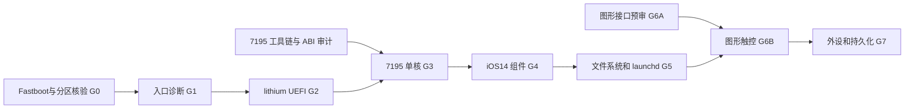

# iOS 14 → 小米 MIX 一代：实施计划

制定日期：2026-11-12。工作目录：`F:\IOS-MIX1`。目标：lithium / Snapdragon 821（MSM8996pro）/ Adreno 530。

**2026-11-13：lithium 专用 XNU7195 已完整构建，QEMU 真实执行到 `kernel_bootstrap`，静态指令检查通过。** BSD 前 SHA1 接口表为空，正在回移真实加密实现并继续追踪初始化。QEMU Cortex-A76 结果不代替 Kryo 真机验证；真机 XNU、iOS 用户空间及最终 UI 尚未运行。按用户要求继续复用 ios-sailfish、UniXNU 与 Apple7195，原厂 Linux 恢复实验保留为辅助资料。证据、复现与下一步见 `reports/ios14-xnu-bringup.md`。

**2026-11-12 路线调整优先于下文旧阶段排期：** 下一项主要验收是7195内核构建，不继续以增加原厂Linux启动标记替代iOS移植。iOS14目标、原生运行和最终SpringBoard/触摸/应用标准保持不变。

主目标固定为 **iOS 14**，首选输入 **14.8 / 18H17 / iPhone8,1 / n71ap / 普通 ARM64**。原始内核已验证为 **XNU 7195.140.44**。7195.141.2 只作邻近开源参考。iOS 16/17 的源码和补丁只能提供方法，不能替代本项目的系统与 ABI 基准。

## 1. 怎样才算完成

| 等级 | 验收定义 | 是否满足最终目标 |
| --- | --- | --- |
| M0 | 可恢复、可重复构建、输入与日志可追溯 | 前置条件 |
| M1 | MIX 上临时启动诊断引导/UEFI，可靠日志和异常信息可取回 | 中间结果 |
| M2 | 7195 内核在真机稳定运行，内存、时钟、中断及任务切换经过验证 | 中间结果 |
| M3 | iOS 14 的 dyld、launchd 和必要服务启动，根文件系统可读 | 中间结果 |
| M4 | 真机 SpringBoard 持续显示 ≥30 分钟，触摸可操作，能打开设置及一个系统应用，重复启动 5 次 | **本项目主要成功标准** |
| M5 | 可持久存储、联网、音频、电量/充电与基本电源管理稳定 | 扩展可用性目标 |
| M6 | 通话、相机、休眠、性能、长期稳定和全部外设 | 单独评估，不包含在 M4 的承诺中 |

M4 可以暂时性能较低，但必须是 iOS 14 用户空间在 MIX 上实际运行。静态苹果 Logo、UEFI 菜单、Android 仿 iOS 界面、仅 Darwin 控制台或在电脑上的模拟器结果都不能替代它。软件图形路径只有实际通过 M4 才算成功。

## 2. 已完成与证据入口

| 已完成工作 | 证据 |
| --- | --- |
| 两个原项目和 UniXNU 20 个声明子模块已下载并固定提交 | `upstreams.lock.json` |
| 本机只读探测，确认 lithium / 6GB 级 RAM / 256GB 型号、Android 7、对应 MIUI | `reports/initialization-2026-11-12.md`；最新详细日志在 `reports/local/latest.json` 指向位置 |
| 同版本原厂 boot/recovery 校验、20 个 DTB 提取、唯一匹配和 dtc 往返验证 | `reports/stock-firmware.md`、`.json` |
| 运行时 1898 节点、14615 属性、RAM 和保留区快照 | `reports/live-memory.md`、`.json` |
| Apple manifest、14.8 原始内核解压、长度/Adler32/Mach-O/217 个预链接组件解析 | `reports/ios14-inputs.json` |
| Gree 参考内存冲突及 MIX XBL/aboot ELF 程序头解析 | `reports/platform-inputs.json` |
| Fastboot 双解锁、返回 Android、实际68个分区名称和范围 | `reports/device-readiness.md`、`reports/fastboot-status.json`、`reports/partition-map.json` |
| 三次 ARM64 真机入口诊断、原厂重启对照和 10 项 QEMU 执行验证 | `reports/entry-bringup.md`、`reports/entry-state.json`、`reports/entry-probe-qemu.json` |
| 一次显示真机采样、真实 BGR24 布局及空 memreserve 表；10 项 QEMU 检查 | `reports/display-bringup.md`、`reports/display-state.json` |
| lithium UEFI 构建、GOP 与定时器及完整原厂内核恢复的 QEMU 验证 | `reports/uefi-build.json`、`reports/uefi-qemu.json` |
| 十轮UEFI临时尝试；EFI入口、复制读回、Linux MMU后钩子有目视证据；未启动XNU | `reports/uefi-bringup.md`、`reports/uefi-device-attempt-10.json` |
| FAT12/mtools 读回、实际 EFI 入口/协议、普通/严格 QEMU、损坏文件拒绝 | `reports/uefi-payload.md`、`reports/uefi-payload.json` |
| 扩大 ramdisk 与 initrd 独立诊断，14 项 QEMU 及一次真机同次日志、原厂重启对照通过 | `reports/handoff-bringup.md`、`reports/handoff-probe-device.json` |
| 研究源码提交、远程 7195 标签观察、Mu 基准提交 | `reports/research-upstreams.lock.json` |
| 哪些是实测、源码事实、作者报告及缺口 | `reports/source-audit.md` |

已于 2026-11-12 实际进入 Fastboot，确认 `Device unlocked: true`、`Device critical unlocked: true`，并返回 Android。Fastboot 的 product 为 `MSM8996_A8`，对应重启前后均核验为 lithium 的同一台设备；空值查询不当作有效结果。详见 `reports/fastboot-status.json`。

**用户已免除备份要求，授权必要时自行 root 和清除数据。** 该授权覆盖后续同机操作，不再把数据备份作为启动/刷写门槛；完整记录见 `OPERATIONS.md`。当前尚未 root、清除或刷写；三次诊断使用 Fastboot 临时启动，最后已普通重启回原厂系统。

## 3. 路线与依赖

优先路线：原厂启动链 → Android boot v0 容器中的 ARM64 诊断 shim → 最小 lithium UEFI → DarwinBoot/7195 版 boot_args 与 ADT → 移植 7195 内核 → 14.8 组件和用户空间 → 显示/图形/HID → SpringBoard。



G6A 在 G1/G2 期间并行做静态研究，避免直到大量硬件开发后才发现 UI 路线不成立。计划不要求把所有硬件先做好再试用户空间：首轮使用 RAM/只读镜像，单核、保持显示扫描输出、暂不启用基带和深度休眠。

## 4. 工作包、门槛与失败分支

### G0：Fastboot、恢复材料与真实分区

**前提：**已核验 lithium 身份并保留用户提供的原厂固件和哈希。根据用户授权，跳过手机备份；原厂包仅作为已有恢复材料，不宣称包含本机独有数据。

**工作：**

1. Fastboot 会话已完成：解锁/critical 解锁均为 true，最大下载量 `0x20000000`，userdata 返回实际容量和 ext4；已返回 Android，`sys.boot_completed=1`。版本、boot/recovery 容量和 current-slot 查询返回空值，仍记未知。
2. 已用普通 ADB 取得 sysfs 的68个 PARTNAME、起始和容量，建立 `reports/partition-map.json`。boot=sde36、recovery=sda13，均为64MiB；userdata=sda15，250,710,192,128字节，与 Fastboot 一致。磁盘逻辑块4096字节；原始 GPT 尚未读，涉及 GPT 改动时再核验原始表。原厂 `userdata=4194304KB` 不作实际容量依据。
3. 先用普通 ADB 读取可见 sysfs/proc 信息。需要完整 FDT、保留内存或块设备权限时，可自行使用适配 lithium、已核验来源的临时 recovery 或基于匹配 stock boot 的 root 方案；每次记录镜像来源、哈希、变更范围和实测结果。
4. binary 传输使用 Python 捕获 `adb exec-out` 的原始 stdout。现有 MIUI shell 通道会改写换行，不能用 PowerShell 文本重定向或普通 `adb shell cat` 传输 FDT/镜像。
5. 允许为实验清除数据；在具体存储方案、实际范围和镜像就绪时执行。当前继续取材和入口分析，无需为了获得授权而先执行一次清除。

**关于 root：**已获得用户授权，无需重复确认。root 是获得所需观测或调试能力的一种实现选择；若普通 ADB 足够则继续使用，若需要则根据匹配 boot/recovery 和当前 Android7 环境选定具体方法。

**产物：**已产生 `reports/fastboot-status.json`、`reports/block-geometry.json`、`reports/partition-map.json` 及本地原始查询日志。不要求 backup-manifest 或手机备份。

**通过：**解锁及返回 Android 已验证，后续所需操作的目标分区/容量和镜像参数已核验，原厂恢复输入可用；备份不是通过条件。原厂批处理仍逐行审查，避免无关的重新锁 BL 或引导链改动。

**失败分支：**临时启动不受支持时，根据已核验的分区和输入评估必要的 boot/recovery 写入，不再因未备份而停止。入口和内存布局仍未确定的实验固件继续在 PC 侧修正。EDL 能力仍以实测为准，不由 firehose 文件存在推定。

### G1：证明 ARM64 入口、CPU 能力和占用表

**2026-11-12 实测进展：**入口/CPU 部分已完成。三次临时启动的 512 字节记录一致，均为 EL1、内核 `0x40080000`、FDT `0x42800000`；4K/16K/64K granule 均支持、PA 44 位、无 LSE、CNTFRQ 19.2 MHz、入口 MMU/缓存关闭。10 项 QEMU 检查包含同级异常恢复；手机未注入异常且三轮均无捕获异常。最后原厂重启及诊断属性消失已验证。见 `reports/entry-bringup.md`、`reports/entry-state.json`。完整 UEFI 占用表及显示交接仍待完成，不将 G1 整体标为通过。

**前提：**G0 通过。先离线分析 MIX 自有 aboot 的 Android header、gzip、DTB 选择、32→64 位转换与跳转路径；ELF32 aboot 不等于最终只能进入 32 位内核。

**工作：**

1. 建立按阶段区分的占用表：下载/压缩输入、解压目标、aboot/XBL 仍存活区域、FDT/memreserve、splash、SMEM、安全/外设 carveout、shim、FD、堆栈、页表、日志、ramdisk。每项记录来源、生命周期和映射属性。
2. 先制作最小 ARM64 诊断 shim：仅在已证实的启动容器范围执行，保存入口寄存器与 FDT 指针；使用独立异常向量，记录 CurrentEL、MIDR/MPIDR、ID_AA64MMFR0、ID_AA64ISAR/PFR、CNTFRQ、SCTLR、TCR、TTBR 和可访问的缓存参数。不可读寄存器的异常也要能报告。
3. 验证 CPU 的 4K/16K translation granule、PA/VA 位宽、原子指令、定时器访问和 PSCI/SMC 条件。先按 ARMv8 基础指令构建，不能因上游 ARM64 配置就启用 PAC/LSE 或 Apple 专用寄存器路径。
4. 获取可导出的日志通道。先核实 UART 地址、pinmux、时钟、接线/电平及实际输出；USB 调试需单独驱动，不假设 Android ADB 在 shim/UEFI 中存在。早期屏幕标记可定位阶段，完整异常记录须通过已验证通道导出；内存环形缓冲能否跨重启保留需实测。
5. 读取继承的显示控制状态和 FDT，不盲扫 MMIO。Android 1080×2040、虚拟 1080×4080 只说明 Android 状态；实际 bootloader scanout 的物理地址、stride、像素格式、方向和缓存策略须另证。

**关键限制：**MIX aboot 的 PT_LOAD 为 `[0x92a00000,0x92bd74f8)`。Gree FD 的 `[0x92000000,0x92300000)` 及日志区仍落在 MIX peripheral 保留区；FV Region 落在 modem 区。不得按“看起来有空洞”直接指定新地址。XBL ELF 段也要区分阶段，不能把所有历史加载段永久保留或全部释放。

**产物：**已生成 `reports/entry-state.json`、`reports/boot-occupancy.json`、本地原始入口记录，以及 `out/entry-probe/lithium-entry-probe.img` 和带 SHA-256 的构建/模拟验证报告。当前占用检查仅覆盖原厂内核串联探针；完整 UEFI 分配图仍待实现。

**通过：**至少 3 次临时启动得到一致入口与 CPU 信息，异常可定位，能返回原系统；任何可写范围均有依据，区间检查无未解释冲突。首次诊断不是先把完整 FD 搬进未知窗口。

**失败分支：**无第一条标记时依次查 header/解压/DTB/分支/执行状态；中途同步异常查 ELR/ESR/FAR；固定时间重启查经证实的看门狗路径。仅在原固件明确的机制内处理看门狗，不修改 EL3/安全固件。入口模式仍不明确时回到 aboot 静态分析。

### G2：建立最小 lithium UEFI

**2026-11-12 最新进展：** 第十轮目视通过原厂Linux的MMU后高虚拟地址钩子，手动恢复原厂。主线已转为复用Apple7195、同芯片ios-sailfish及UniXNU组件；已重建26个参考驱动文件，并形成通过应用检查的7195 GIC候选补丁。尚无完整7195内核构建或XNU运行，详见 `reports/reuse-route.md`。

**前提：**G1 通过、加载地址与显示交接已实测。采用新的 lithium 板级目录，参考 Gree 的 MSM8996 通用实现和旧 lithium 材料，不修改原始上游 checkout。

**工作：**

1. 下载 Mu-Silicium 固定基准 `6b3d90b79e191e08171bfedd3980234a7e49d340`，锁定递归子模块；先阅读其实际 AGENTS 和构建要求。Gree overlay 两个补丁作用域不同，分别针对 Mu_Basecore 与 Mu 根目录，逐个检查后移植。
2. 编写 lithium 的 BootShim、MemoryMapLib、DSC/FDF/配置；把 FD 大小、搬移地址、logger、SEC/DXE 堆栈与页表统一为经过区间检查的输入。检查 gzip/ARM64 Image header 的 image_size、boot v0 的各地址/页大小和真实 boot 分区容量。
3. 先启用 CPU/MMU、异常、定时器、日志和继承式 GOP。屏幕测试用四色、坐标格和滚动区域验证 stride/方向/缓存；不直接照抄 Gree 的 24bpp、偏移及 1080×1920 参数。
4. 在 MIX XBL 中扫描 FV/FFS/GUID，核对所需 DXE 的机器类型、协议和版本；优先使用本机来源或源码实现。Gree 所需 SPMI 二进制不能按文件名从 MIX 或其他手机随意替换。初版可裁掉 UFS、网络、触摸等非启动必需模块。
5. 通过 ramdisk 中的只读 FAT payload 暴露文件，验证 DarwinBoot EFI 加载路径；退出 Boot Services 前保存最终内存图、保留日志和 payload，明确哪些区域可以交还 XNU。UEFI BlockIo 的存在不代表退出后 XNU 仍能访问 UFS。

**通过：**3 次进入固件；计时与事件循环运行 ≥10 分钟；GOP 坐标正确；无异常、未解释重启及内存越界；能从 RAM 读取指定文件并哈希一致。构建通过与真机通过分开记录。

**失败分支：**卡 SEC/MMU 查页表对齐和 device/normal 属性；花屏查实际 scanout 而非先写 DSI 寄存器；专有模块缺失先缩减到最小固件。完整 Mu 路线若无可解决依赖，可单独评估诊断 shim 直接传递 7195 boot_args 的加载器，验收门槛保持一致，目标仍是 iOS 14。

### H：7195 构建、页粒度和 ABI 静态审计

该工作包可与 G1/G2 并行，在 G3 前通过最小构建，在 G4 前通过组件 ABI 审计。

1. 建立工作副本/补丁树，基于已固定的 7195.141.2 进行差异研究。原始 14.8 是 7195.140.44，远程标签未发现精确源码；不能只改版本号后认定匹配。
2. 先编译并链接一个 ARM64 Mach-O、一个内核对象、MIG 生成接口及一个最小 IOKit 类，验证 clang、ld64、libtool、nm、MIG/IIG、头文件、libplatform/libpthread/corecrypto 等实际依赖。7195 的导出符号、C++ ABI、结构偏移及构建选项要留档。现有 clang18 只是可用工具，UniXNU 新内核工具链安装器不是 7195 保证。
3. 对每条上游补丁记录“意图/7195 对应代码/改写/测试”，分成 arch、SoC、OS、board；先实现非 Apple CPU 和平台必需路径，去掉 Apple 专有寄存器访问。不能直接应用 10063 或 8796 的整个 patch series。
4. 核实 granule 后选择分页路线：若硬件、7195 与目标组件都能验证 16K，则评估保持目标页语义；否则走 4K，并覆盖 bootstrap 页表预算、pmap、VM/commpage、mmap、dyld shared region、CodeDirectory 签名粒度、kext 对齐和 DMA/SMMU。UEFI 页粒度与 XNU 页粒度分别验证。
5. 默认最小实验优先验证 7195 BCM2837 的通用 ARM64/4K 支架，但它不是 MSM8996 平台。对比 14.8 二进制导出、内核接口组件、符号、类/vtable、OSMetaClass、锁/线程/内存接口及语义，建立绑定清单。符号名字相同也不等于 ABI 相容。

已完成的子项：ARM64 Mach-O 最小编译/链接、7195 boot_args 双目标校验、DarwinBoot EFI、7项命令行检查与真实14.8内核解析；随后通过 MIG/IIG、IOKit 与完整 lithium 内核构建，并在 QEMU 验证16K启动页表和早期初始化。源码构建部分已通过；14.8私有组件绑定、Kryo真机运行与完整 VM/用户空间页语义仍未验证，不能把整个 H/G3 门槛设为通过。见 `reports/ios14-xnu-bringup.md`。

**通过：**可重复构建、完整命令与工具版本可追溯；原始内核与源码差异有清单；所有选入组件的绑定均唯一且有依据，未知项显式阻止下一门槛。若邻近源码的差异不可控，评估另一份实际验证过、源码匹配更好的 **iOS 14.x** 输入；更换时同步 manifest/内核/ABI/用户空间所有 pins，不能混用，也不自动改成 iOS 16/17。

### G3：7195 单核启动与平台基础

**前提：**G2 和 H 的最小构建通过。使用自有 platform 层和单核配置，初期只开放经过证实的一段 RAM，逐步扩大。

**工作：**

1. 按 **7195 的 `pexpert/pexpert/arm64/boot.h`** 编译验证 boot_args 的大小/偏移，适配 DarwinBoot；Linux FDT 与 Apple ADT 是不同格式，显式生成 `/chosen`、`/memory-map`、CPU、时钟、显示等节点并对照内核实际读取路径。原设备身份与物理 lithium 资源分开描述。
2. 检查 EL、cache/MMU 初始状态、物理/虚拟基址、slide、内核/payload/ADT 的保留；给 `_start`、页表建立、MMU 切换、arm_init、平台初始化、首个线程加检查点和异常转储。
3. 使用本机 GICv3 GICD `0x09bc0000`、GICR `0x09c00000`；CPU 拓扑 MPIDR 为 `0,1,0x100,0x101`，先只启动主核。定时器频率为 19.2MHz；DT PPI 13/14/11/10 对应 raw INTID 29/30/27/26，实际选择结合入口 EL/控制寄存器实测，不能加减两次 16。
4. 完成异常、GIC redistributor、timer tick、调度、内存分配、cache/TLB 与基础 syscall；测试保留区不可分配、页表不溢出。扩展 RAM 时检查 64 位物理地址，尤其 >4GiB 的页号转换与 DMA 上限。
5. 单核稳定后再做 PSCI CPU_ON、每核 GIC/timer、跨核 IPI 与 cache 一致性；SMP 失败可继续单核用户空间研究，但记录限制。

**通过：**真机稳定 ≥10 分钟；timer/调度可观测；测试线程分配/释放及边界访问正确，异常注入能打印完整现场；3 次重复临时启动。只出现一条内核版本字符串不算通过。

**失败分支：**MMU 前后分别定位页表与入口状态；timer 无中断区分计数器在走、PPI pending、路由和 mask；高内存故障限制 RAM 后做二分测试。QEMU 可验证通用启动/解析和工具链，不能替代 Kryo/GIC/显示真机验收。

### G4：iOS 14 预链接组件与系统接口

**前提：**G3 与 H 的 ABI 审计通过。所有二进制组件来自同一份已验证 14.8 输入。

**工作：**

1. 为 `ios-14.8-18H17` 建立独立 profile，集成 complzss 检测和解码；固定解压内核 SHA-256、设备身份、版本、ADT 和真实组件集合。当前解码脚本完成输入研究，profile 尚未实现。
2. 从实际 217 项预链接信息计算依赖闭包，按需引入 KPI、crypto、IOStorage、APFS、IOSurface、HID 等。不能复制 17.7.11 profile 的 roots、slide、初始化地址或私有类 ABI。
3. 适配预链接器到 7195 的段布局/重定位/符号；检查唯一绑定、未解析导入、构造器、vtable、跨段引用、kmod 与初始化顺序。每个函数地址从目标二进制与反汇编证明，禁止沿用别的系统常量。
4. 对 corecrypto、AMFI/CoreTrust/sandbox、Image4、trust cache、随机源和时间源建立最小可观测路径；保留原始系统文件，实验改动以可重放 patch 清单记录。找不到 Apple 平台/SEP 依赖时明确标记缺失接口，不用全局返回成功隐藏错误。

**通过：**预链接报告没有未解释绑定；基础组件可以初始化，IORegistry 可导出；已知哈希/AES 测试向量通过，代码签名与文件访问失败能定位到具体路径。未启动原始 Apple GPU/SEP/PMGR 驱动去访问 Qualcomm MMIO。

**失败分支：**某组件与邻近源码存在结构或语义差异时回到 H，重建对应兼容层或缩小组件集合；不能让静态预链接成功代替运行验证。

### G5：根文件系统、Data 与 launchd

**前提：**G4 的 IOStorage/crypto/文件系统接口可用；先使用 RAM 驱动或明确的只读存储，不重新划分手机。

**工作：**

1. 通过 manifest 的 `OS` 组件 **`018-62051-016.dmg`** 取得实际根文件系统材料；检查 ZIP/DMG/文件系统/加密属性、整文件哈希和空间需求后再提取。不能把 restore ramdisk 当成完整 iOS，也不能沿用 17 系统的 Cryptex 布局假设。
2. 对镜像做离线只读检查，固定 root UUID、卷/快照关系和需要的挂载策略。14.8 APFS 组件为 1677.142.1，需验证读块、挂载、目录/符号链接、压缩文件、mmap 和 dyld cache 读取。
3. 验证小型测试 init → 真实 iOS 14 dyld → 原始 `/sbin/launchd`。测试 init 只是诊断，不替代 launchd。检查 Mach trap/syscall、TLS、线程、shared region、commpage、时间和签名验证。
4. 建立与实际 14.8 文件布局匹配的空白、可丢弃 Data seed，明确 System/Data 的挂载点、权限、所有者、链接、日志和启动服务配置。RAM Data 足够再继续；若容量不够，先完成受控存储方案，而不是覆盖 Android userdata。
5. 逐项处理 AppleKeyStore/SEP、平台身份、MobileGestalt、lockdown、backboardd、runningboardd 等依赖；服务是否必需、实际路径和调用以 14.8 文件及日志为准。用新的实验数据、没有密码和生物识别的最小场景检验软件替代接口；不宣称获得 Secure Enclave 的硬件安全等价物。

**通过：**根文件系统只读挂载、采样文件哈希一致；launchd PID1 运行 ≥10 分钟，必要服务没有持续崩溃重启，命令/诊断通道能读取进程表和日志；3 次重复启动可复现。未经验证的 root UUID、Data seed 和服务地址不得从其他版本复制。

**失败分支：**挂载失败先分块设备/APFS/KPI/策略；dyld 失败区分页粒度、缓存映射、签名和缺库；launchd 卡住按具体 job/IOKit 等待追踪；SEP/平台服务的不可满足依赖作为显式阻塞项保留。

### G6A / G6B：图形可行性与触摸，决定能否达到主目标

**G6A 提前研究：**原始内核的 IOSurface 290.7、IOGPUFamily 21.9、IOMobileGraphicsFamily 343.0.0，以及 OS 镜像中对应用户库是绑定依据。建立 IOSurface/显示用户客户端 selector、结构、映射、同步/fence、vblank 与窗口合成调用清单。Adreno740/Metal 现有实现不能据名称迁移到 A530。

| 候选路线 | 需先证明的实验 | 继续条件 |
| --- | --- | --- |
| 继承 framebuffer + CPU 合成/兼容服务 | 在真实 14.8 显示栈下分配、共享、填充和呈现 IOSurface，满足必要 client 调用 | 能连续显示并响应 UI 更新，必要服务不因缺 GPU 接口退出；仅能画矩形则不够 |
| 原生 A530 + 图形接口桥 | 时钟/电源/固件/SMMU/提交/中断、buffer/fence，再实现 14.8 所需的图形用户接口 | 先证明单次安全提交和结果校验，再验证图形前端；现有探测框架不计作渲染支持 |
| 软件图形前端 | 实测 CoreAnimation/必要 Metal 或 GL 调用能被软件实现承接，映射到显示服务 | 能运行目标 UI，且内存和性能足以操作；无此证据不能承诺软件渲染能救场 |

Freedreno 等外部实现可作 A5xx 寄存器/命令流研究资料，但需要另行固定源码和许可证并完成 XNU 驱动及 iOS 接口适配。任何 Vulkan→Metal 或其他桥接设想均须验证两端实际能力，不能当成现成方案。

**G6A 通过：**有明确到函数/协议的路线、可运行的小型显示/共享缓冲实验，以及阻塞接口清单；先给该路线设 4–6 周的首轮研究时间盒。若三条路线均不能证明必要接口可满足，保留 M2/M3 成果，评审 UI 目标的投入与可行性；不能把控制台结果宣布成整个项目完成。

**G6B 工作：**

1. 接通 MDP5/DSI 的继承扫描输出到 iOS 显示服务，验证 IOSurface、颜色格式、缓存一致性、present 完成和帧更新。初版禁止休眠/模式切换；以后再做面板重新初始化和亮度。
2. 本机触控 DT 绑定为 `ft5x46_i2c@38`，控制器在 `0x075ba000`，地址 `0x38`。reset GPIO89、IRQ GPIO125 及供电/触发极性以 DT 和真机验证为准；不要因为固件文件名中有 ft8716 就换用 Gree 的触摸配置。
3. 先实现 BLSP/I2C 的受控读和中断，再读取触点帧，验证 ID、坐标范围/旋转、多点、按下/抬起，最后接入 14.8 的 IOHIDDigitizer 事件链。Linux 驱动只作协议参考；不得写触控固件升级命令。
4. 启动 backboardd/SpringBoard，逐个收集失败的显示、键盘、按键、平台与图形调用。增加音量/电源及返回主屏的操作方式，记录哪些系统应用受缺失硬件影响。

**通过：**达到 M4：SpringBoard ≥30 分钟，真实触摸滑动/点击可用，打开设置和一个系统应用，5 次独立启动可复现；记录帧时间、内存和温度。临时注入触摸可以定位显示问题，不能替代最终真机触控验收。

**失败分支：**黑屏按显示服务注册/IOSurface/client 返回/提交完成拆分；GPU 超时检查固件、SMMU、时钟、fence，不通过跳过等待伪造完成。无法取得图形前端则回 G6A，不能靠无限增加平台 stub 宣称支持。

### G7：持久化及外设，按价值逐项加入

**前提：**对应单项接口已验证；实验磁盘写入前确认实际目标、容量和镜像一致，按用户授权可清除数据，不要求备份。

| 顺序 | 工作和产物 | 验收 |
| --- | --- | --- |
| 1 | 原生 UFS8996：PHY/时钟/电源、DMA/SMMU、读块、IOStorage；UEFI 退出后用自己的驱动 | 先只读跨范围抽样与原始文件对比；后续仅在已隔离的测试卷做写入/断电恢复测试 |
| 2 | 电量、充电、PMIC/温度与亮度 | 与 Android 取材对照，长时间负载温度可观测，充电与恢复路径可靠 |
| 3 | Wi-Fi，再蓝牙 | 从本机 DT/固件确认实际芯片、总线、校准文件；完成供电、固件、传输、网络接口；DHCP/持续传输/重连可复现 |
| 4 | 音频、麦克风、传感器 | 路由、时钟、DSP/编解码器逐项验证；播放/录音和传感器读数有结果 |
| 5 | SMP、频率、休眠/唤醒 | 每核定时器/IPI 稳定；冷启动和多轮唤醒通过，没有 DMA/显示恢复损坏 |
| 6 | 基带/通话，最后相机 | 单独设计调制解调器协议、共享内存、服务及 iOS 上层接入；拨号/收发/恢复真实验证，不能把保留 modem 内存视为通话支持 |

持久化优先复用实际分区边界；也可评估外部介质或文件容器，任何选项都要证明 XNU 可直接访问。用户已允许必要的全清；采用 userdata 实验时，依据真实 GPT、块大小及镜像容量落实布局后执行，不再因备份等待。不得照抄 Gree 的 LBA、UFS 扇区大小、userdata 窗口。

## 5. 项目结构与可复现要求

根仓库保存 scripts/reports/计划/锁文件；原始 upstream checkout 保持干净。实施时拟新增以下目录（当前尚未实现）：

| 目录 | 内容 |
| --- | --- |
| `ports/lithium/` | board/feeds/defconfig、板级 DTS、资源与验收记录 |
| `ports/msm8996/` | 经核验的 GIC/timer/PSCI/BLSP/UFS 等通用代码与补丁 |
| `profiles/ios-14.8-18H17/` | manifest/哈希引用、7195 ABI、预链接依赖和系统补丁 |
| `firmware/lithium/` | 独立 BootShim/UEFI overlay，禁止继承未核验地址 |
| `patches/xnu-7195/` | 按意图拆分的 arch/SoC/OS/board 补丁 |
| `out/`、`artifacts/` | 本地构建产物、系统材料和日志，继续忽略 |

每次真机实验归档：源提交、补丁集哈希、工具版本、完整命令、镜像哈希与大小、内存布局、设备身份、起止时间、检查点/异常、恢复结果和该门槛的通过/失败。制作脚本应在机型/输入 pins/区间/容量任一不匹配时失败退出。

厂商/Apple 原始二进制只保存在本地；公共仓库保留脚本、补丁及必要哈希，不把原始 IPSW、rootfs、私有备份和本机启动参数提交上去。

## 6. 主机、存储与投入预算

实测主机为 WSL2 Ubuntu、24 逻辑 CPU、约 23GiB WSL RAM、4GiB swap；clang18、dtc、cmake、ninja、QEMU 等已存在。完整工具链尚未配置。WSL 的约 900GB 虚拟可用空间不代表实际物理空间；其 VHD 位于 D 盘。

本轮观察的物理空余约 F 31.9GB / C 15.3GB / D 83.4GB；重型编译前重新核对。固件/材料保留 F 盘，重型构建优先放 WSL ext4。不要在 `/mnt/f` 反复生成 LLVM/XNU 大量小文件。

| 阶段 | 规划资源范围（非测量结果） | 执行策略 |
| --- | --- | --- |
| 最小 shim/UEFI | 额外预留 15–30GB | 先证明固件可构建，不先重编整套 LLVM |
| 7195 工具链/XNU | 按需预留 30–60GB；若从源码重编 LLVM 可能还需额外 40–80GB | 先试已验证的预构建/最小工具；完整重编前扩大物理余量或释放可再生构建产物 |
| IPSW/rootfs/多个迭代镜像 | 完整 IPSW 4.741GB，另预留 15–30GB | 先按 manifest 取所需成员，检查空间后再完整提取 |
| 手机备份 | 用户明确不要求 | 不下载或创建整机备份；按实验输入和构建产物预算空间 |

首轮编译按 6–8 任务起步，观察内存再调整；不以 24 核并发默认启动大规模链接。需要 macOS 专有镜像工具的工作包可使用具备对应工具的 Mac；Windows/WSL 现状不足以宣称这些步骤已经可用，不默认购买硬件或调用远程收费服务。

以下是具备内核/UEFI 经验、能持续投入时的**时间盒估计**，不是交付日期：

| 工作包 | 首轮时间盒 | 到期要交付的判断 |
| --- | --- | --- |
| G0/G1 | 1–3 周 | 分区、入口、CPU、内存和日志是否足以继续；Fastboot 已完成 |
| G2 与 H 最小构建 | 2–6 周，可并行 | UEFI 和 7195 工具链能否成立 |
| G3 | 4–10 周 | 真机单核平台是否稳定 |
| G4/G5 | 6–16 周或更长 | 14.8 ABI 与 launchd 路线是否成立 |
| G6A | 4–6 周，尽早开始 | 软件/原生图形路线至少一条是否有具体证据 |
| G6B | 8–24 周以上 | 是否真正达到 SpringBoard+触控 |
| G7 | 数月，按单项另估 | 各外设能否加入 |

依赖问题可能使任一阶段长期阻塞；一个人业余投入应按多个月至一年以上的研究准备，仍可能无法达到 M4。不能把“系统更旧”换算成“几个驱动就能成功”。

## 7. 风险与决策点

| 风险 | 当前证据/未知 | 决策与处理 |
| --- | --- | --- |
| 固件写坏保留内存 | 已发现参考 FD/logger/FV 与 MIX 冲突 | G1 分阶段占用表通过之前不运行完整移植固件 |
| 原始内核与开源版不完全一致 | 7195.140.44 vs 7195.141.2 | H/G4 逐接口审计，必要时评估其他已验证 iOS14.x 组合 |
| 页语义与用户空间不相容 | 真机已确认支持 4K/16K/64K；7195/用户空间路径尚未验证 | H 评估保留16K，检查整个 VM/dyld/签名链，不能只改宏 |
| 图形无法支撑 iOS UI | A530 探测框架非渲染驱动，Apple GPU 不兼容 | G6A 提前验证；到期评审路线，不把 M3 改名为成功 |
| SEP/KeyStore/平台服务依赖 | 目标组件存在相关依赖，替代接口未做 | G5 最小无个人数据环境逐项验证，记录功能和安全边界 |
| UFS/触控/PMIC 实现不完整 | 同 SoC 参考多处为 scaffold/stub | 分别验收真实 I/O、DMA、事件与供电，不能以驱动挂载节点作为通过 |
| 恢复能力不完整 | 有原厂包，Fastboot 已实测，用户免除备份 | 使用已有恢复输入；不将备份作为门槛，不依赖未经实测的 EDL |
| 资源耗尽 | F/C 空余有限，D 也无法同时容纳全部大构建 | 分阶段下载/构建，重编 LLVM 前落实真实容量 |

遇到不可满足的门槛时，交付最后可复现的结果、日志、确切失败接口及候选实验。评审可以结束某条研究路线，但不能把未完成的整机目标标为已完成。

## 8. 接下来从哪里开始

**当前先推进可复现的7195内核构建和真正进入XNU。** 已有入口、显示、FAT/EFI及原厂Linux MMU后的真机目视证据；旧恢复实验归档为辅助工具。复用清单、同芯片参考源码和下一阶段验收以 `reports/reuse-route.md` 为准。按已有授权在需要时自行root或清除，不等待手机备份。

现在已经可执行的复现命令，均不刷写手机：

```powershell
Set-Location F:\IOS-MIX1
python scripts/probe-device.py
python scripts/capture-live-dt.py
python scripts/decode-ios14.py
python scripts/audit-platform-inputs.py
```

前两项要求连接已授权 lithium；后两项完全离线。`scripts/inspect-ios14.py --kernelcache` 可从固定 Apple URL 重新取 manifest/内核，联网且有流量上限；重新取材后再运行解码检查。

入口实验的完整复现命令如下。最后一条会实际重启手机、临时启动三次并最终普通重启回原厂；其余三条只操作电脑上的文件：

```powershell
python scripts/analyze-aboot.py
python scripts/build-entry-probe.py
wsl -d Ubuntu --exec python3 /mnt/f/IOS-MIX1/scripts/validate-entry-probe.py
python scripts/boot-entry-probe.py --boot --runs 3
```

该版 aboot 已实测接受本项目的固定诊断镜像；这不保证其他镜像能启动。当前设备端已有入口观察代码，最小 UEFI 的基础阶段已由屏幕目视证实，完整 G2 和恢复交接仍待验证；7195 平台移植与 iOS 用户空间尚未实现/启动。诊断源码、精确哈希与验证边界见 `reports/entry-bringup.md`、`reports/uefi-bringup.md` 和 `reports/handoff-bringup.md`。
